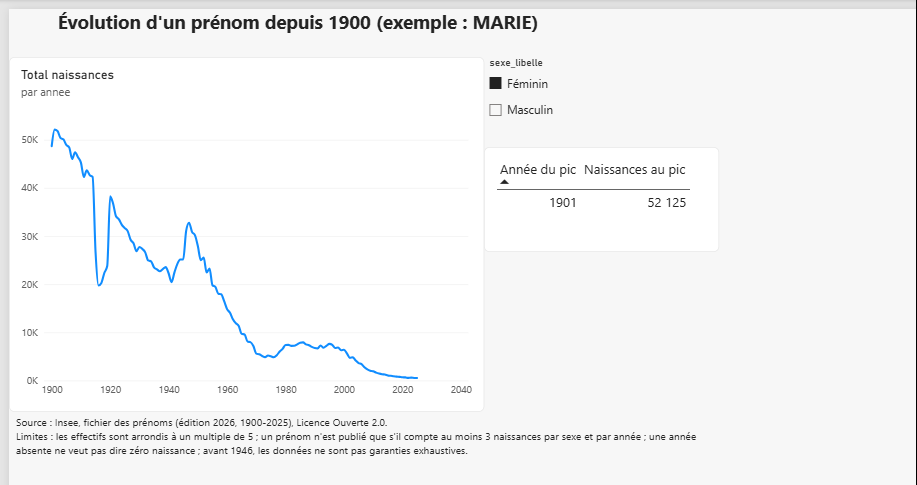
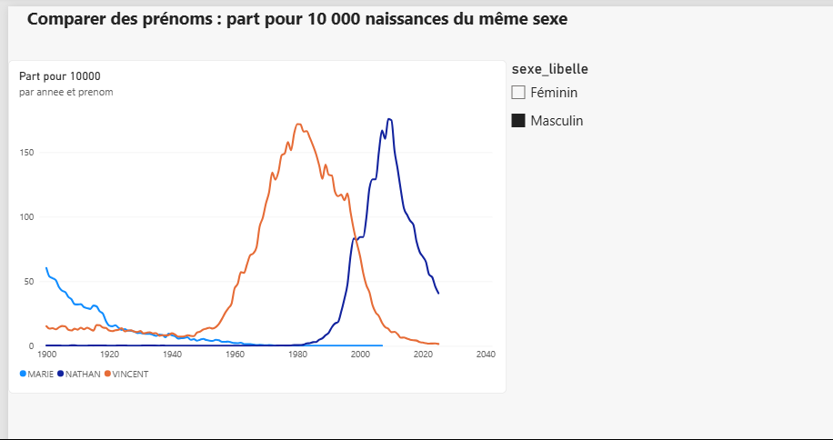
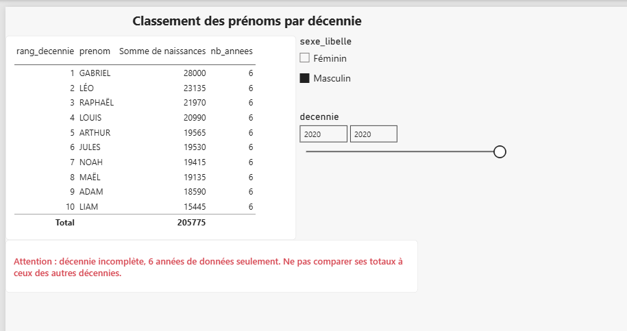
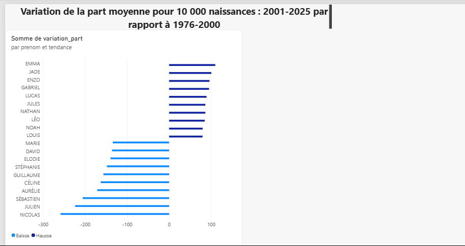

# Prénoms donnés en France depuis 1900 (INSEE)

Analyse de l'évolution des prénoms en France (1900-2025) : pipeline Python
(nettoyage, indicateurs, tests) et rapport Power BI à 4 pages.

## Questions auxquelles le projet répond

- Comment un prénom évolue-t-il d'année en année, et quand a-t-il atteint son pic ?
- Comment comparer plusieurs prénoms de façon équitable ?
- Quels sont les prénoms les plus donnés dans chaque décennie ?
- Quels prénoms ont le plus progressé ou reculé entre deux périodes de 25 ans ?

## Source des données

- **Jeu de données** : Fichier des prénoms, État civil, INSEE (édition 2026, 1900-2025).
- **Lien** : https://www.insee.fr/fr/statistiques/8595130
- **Fichier utilisé** : `prenoms-2025-nat.csv` (séparateur `;`, UTF-8,
  colonnes `sexe;prenom;periode;valeur;rang`).
- **Licence** : Licence Ouverte 2.0. Mention obligatoire : « Source : Insee ».
- Les données ne sont pas versionnées dans ce dépôt (voir `.gitignore`) :
  téléchargez le fichier et placez-le dans `data/raw/`.

## Architecture

```
INSEE (CSV) -> data/raw (jamais modifié)
            -> src/charger.py   : lecture + vérification des colonnes
            -> src/nettoyer.py  : renommage, décennie, part pour 10 000
            -> src/indicateurs.py : pic, comparaison, top décennie, tendances
            -> src/pipeline.py  : écrit 5 tables dans data/processed
            -> Power BI (modèle en étoile) : powerbi/prenoms_insee.pbix
```

Modèle de données Power BI : une table de faits (`faits_prenoms`) reliée à deux
dimensions (`dim_annee`, `dim_sexe`), plus deux tables d'analyse
(`top_par_decennie`, `hausses_baisses`).

## Choix techniques

| Choix | Pourquoi | Alternative écartée |
|---|---|---|
| pandas | ~725 000 lignes : tient en mémoire, simple à lire | Polars / DuckDB : inutile à cette taille |
| Part pour 10 000 | Le nombre de naissances varie selon les années : la part mesure la mode | Effectifs bruts : trompeurs d'une époque à l'autre |
| Variation en points, sans pourcentage | Un pourcentage exagère les petits prénoms | Variation en % |
| Power BI | Dashboard interactif demandé pour le portfolio | - |

## Installation et exécution

Prérequis : Python 3.12, Windows, Power BI Desktop pour ouvrir le rapport.

```
python -m venv .venv
.venv\Scripts\activate
pip install -r requirements.txt
python -m src.pipeline
python -m pytest -v
```

`python -m src.pipeline` lit `data/raw/prenoms-2025-nat.csv` et écrit 5 fichiers CSV
dans `data/processed/`. `python -m pytest -v` lance les 11 tests.

## Résultats observés

Mesures faites sur le fichier de cette édition :

- 724 645 lignes, 126 années, 49 162 prénoms distincts, aucun doublon sur (sexe, prénom, année).
- MARIE (féminin) : pic en 1901, 52 125 naissances.
- Décennie 2020 (6 années seulement), garçons : GABRIEL (28 000), LÉO (23 135), RAPHAËL (21 970).
- Tendances 2001-2025 par rapport à 1976-2000 (écart de part moyenne pour 10 000) :
  plus forte hausse EMMA (+109,88), plus forte baisse NICOLAS (-258,43).

## Captures du rapport

| Un prénom | Comparaison |
|---|---|
|  |  |
| **Classement** | **Tendances** |
|  |  |

## Limites des données et de l'analyse

- Les effectifs sont arrondis à un multiple de 5 : une valeur de 5 peut cacher 3 à 7 naissances.
- Un prénom n'est publié que s'il compte au moins 3 naissances par sexe et par année.
  **Une année absente ne veut pas dire zéro naissance** : elle reste vide, jamais 0.
- Seul le premier prénom de l'état civil est compté.
- Avant 1946, l'exhaustivité du fichier n'est pas garantie.
- La décennie 2020 ne contient que 6 années : ses totaux ne sont pas comparables
  à ceux des autres décennies (avertissement affiché dans le rapport).
- Les tendances ne comparent que les prénoms présents dans les deux périodes ;
  les prénoms absents d'une des deux sont exclus. Une variation absolue favorise
  aussi les prénoms déjà très populaires.
- Un prénom peut exister dans les deux sexes : le sexe est toujours à préciser.
- Contrôle qualité avancé (partie B) non réalisé dans cette version.

## Structure du dépôt

```
src/        code du pipeline
tests/      tests automatiques (pytest)
notebooks/  exploration (01_exploration, 03_indicateurs)
powerbi/    rapport Power BI
docs/images captures du rapport
data/       raw (non versionné), processed (non versionné)
```